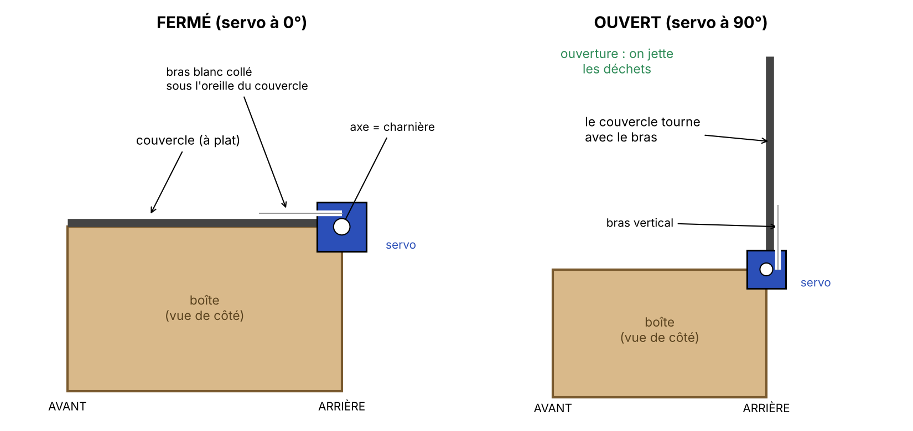

# 🌍 La Poubelle Carbone

Une poubelle à **deux compartiments** (recyclable / autre) qui rend visible l'impact carbone de nos déchets.
À chaque déchet jeté, un faisceau lumineux est coupé, l'Arduino ajoute une **estimation de CO2** et l'affiche sur un écran LCD et sur une jauge de 3 LED. Un couvercle automatique s'ouvre quand une main approche.

> ⚠️ **Les valeurs de CO2 sont des estimations pédagogiques**, pas des mesures. Le projet ne pèse pas les déchets : il applique une valeur moyenne par déchet jeté (20 g pour un déchet recyclable, 120 g pour un autre). Elles se changent dans le code (`CO2_PAR_JET`).

## Comment ça marche

1. Dans chaque compartiment, une **LED** éclaire une **photorésistance** (LDR) placée en face.
2. Quand un déchet tombe, il coupe le faisceau : la valeur lue par l'Arduino chute.
3. Le programme compte le déchet, ajoute les grammes de CO2, fait sonner le buzzer (aigu = recyclable, grave = autre) et met à jour l'écran et la jauge.
4. Au démarrage, la carte **se calibre toute seule** : elle mesure la lumière normale de chaque capteur et en déduit son seuil de détection.
5. *(Option)* Un capteur à ultrasons détecte une main à moins de 25 cm, et un servomoteur soulève le couvercle.

## Matériel

| Quantité | Composant |
|---|---|
| 1 | Carte Arduino UNO R3 (kit ELEGOO) + câble USB |
| 1 | Écran LCD 1602 |
| 1 | Potentiomètre 10 kΩ (contraste de l'écran) |
| 2 | Photorésistances (LDR) |
| 2 | LED pour les faisceaux |
| 3 | LED : verte, jaune, rouge (jauge) |
| 2 | Résistances 10 kΩ (photorésistances) |
| 6 | Résistances 220 Ω (LED et rétroéclairage) |
| 1 | Buzzer passif |
| 1 | Bouton poussoir (remise à zéro) |
| 1 | Breadboard + fils Dupont |
| *option* | Capteur à ultrasons HC-SR04 |
| *option* | Servomoteur SG90 |
| *option* | Condensateur 100 µF |

## Branchements

| Élément | Broche Arduino |
|---|---|
| Écran LCD (RS, E, D4, D5, D6, D7) | 12, 11, 5, 4, 3, 2 |
| Photorésistance du compartiment recyclable | A0 |
| Photorésistance du compartiment autre | A1 |
| LED verte (jauge) | 6 |
| LED jaune (jauge) | 7 |
| Buzzer passif | 8 |
| LED rouge (jauge) | 9 |
| Bouton reset | 10 |
| *Option* Ultrasons Trig / Echo | A2 / A3 |
| *Option* Servomoteur | 13 |

Chaque photorésistance forme un diviseur de tension : 5V → photorésistance → point de mesure (A0 ou A1) → résistance 10 kΩ → GND.

## Utilisation

1. Installer l'[Arduino IDE](https://www.arduino.cc/en/software).
2. Ouvrir `poubelle_carbone/poubelle_carbone.ino` (ou `poubelle_carbone_couvercle/` avec le couvercle automatique).
3. Choisir la carte *Arduino Uno* et le bon port, puis téléverser.
4. Allumer la poubelle **faisceaux dégagés** et attendre 2 secondes pendant le calibrage.

La jauge se lit comme un thermomètre : vert seul sous 200 g, vert et jaune dès 200 g, les trois dès 500 g. Le bouton remet les compteurs à zéro.

### Tester les éléments un par un

Le dossier `tests/` contient des petits programmes pour vérifier chaque partie :

- `test_ecran` : affiche un message sur l'écran LCD ;
- `test_capteurs` : affiche les valeurs de A0 et A1 dans le moniteur série (9600 bauds) ;
- `test_couvercle` : teste le capteur à ultrasons et le servomoteur.

### Réglages

| Constante | Rôle |
|---|---|
| `CO2_PAR_JET` | grammes de CO2 estimés par déchet |
| `SEUIL_JAUNE`, `SEUIL_ROUGE` | paliers de la jauge |
| `BASE_MIN` | lumière minimale pour qu'un capteur soit actif |
| `base * 70 / 100` (dans `calibrer()`) | sensibilité de la détection |
| `ANGLE_FERME`, `ANGLE_OUVERT` | positions du couvercle |
| `DIST_OUVERTURE` | distance d'ouverture du couvercle (cm) |

## Schéma du couvercle

Le servo est collé sur le mur latéral de la boîte, axe vers l'extérieur. Le bras est collé au couvercle, qui tourne avec lui.

## Idées d'amélioration

- remplacer les valeurs moyennes par une vraie pesée avec un capteur de poids (HX711 + cellule de charge) ;
- utiliser des valeurs de CO2 sourcées (par exemple la Base Empreinte de l'ADEME) ;
- enregistrer les statistiques sur une carte SD.

## Licence

[MIT](LICENSE)
